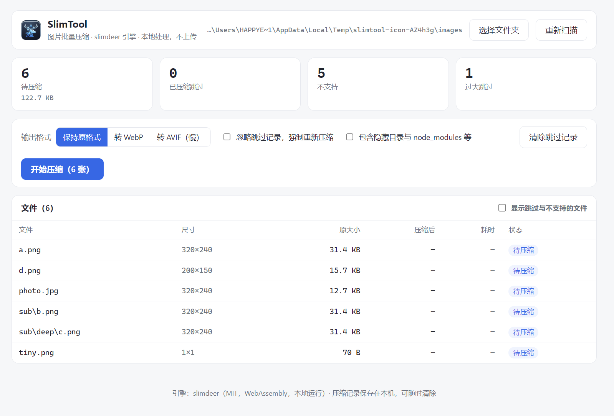
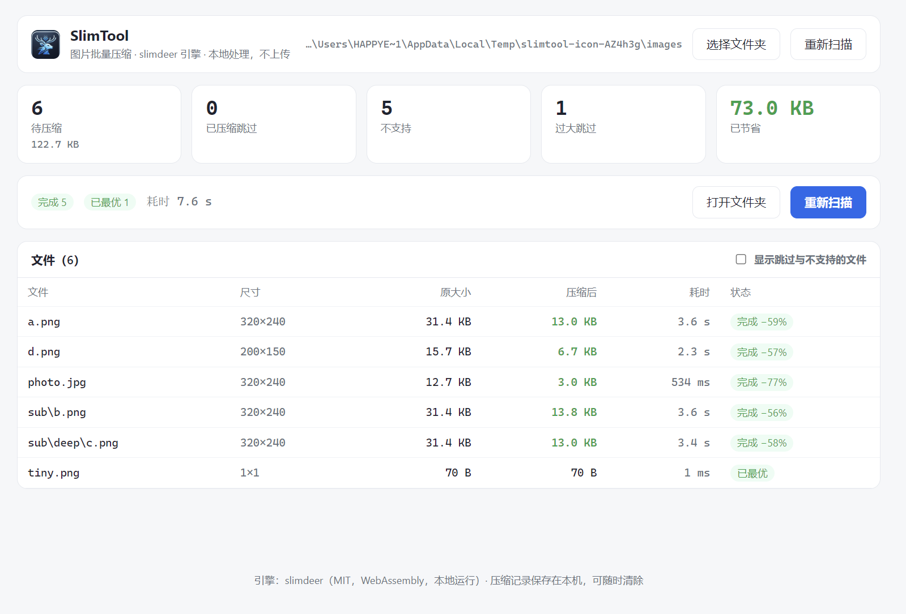

# SlimTool · 图片批量压缩工具

选择项目里的图片文件夹 → 递归扫描 → 先提示有多少张需要压缩（压缩过的自动跳过）→ 一键压缩，**原地覆盖**，文件名不变，前端引用无需改动。

压缩引擎为开源 [slimdeer](https://github.com/heydeer/slimdeer)（MIT，Rust → WebAssembly）：每张图自动搜索最优质量（SSIMULACRA2 感知评分，效果对标 TinyPNG），全程本地运行，不上传任何图片。




## 使用

双击 `release/SlimTool-1.0.0-portable.exe`（便携版，无需安装，可拷贝分发）：

1. **选择文件夹**（或直接把文件夹拖进窗口）。
2. 扫描后先看汇总：**待压缩 / 已压缩跳过 / 不支持 / 过大跳过**，下方是待压缩清单。
3. 选输出格式（默认保持原格式），点「开始压缩」。
4. 完成后显示每张图的压缩率与总节省体积；再次扫描同一目录时，压缩过的文件不再出现在待压缩列表。

### 功能细节

- **支持输入**：PNG（含 APNG 动图，保持动画）、JPEG。gif/svg/ico/webp/avif 等会列出并标记“不支持”。
- **输出格式**：保持原格式（PNG→PNG、JPEG→JPEG）/ 转 WebP / 转 AVIF。转换会生成同名 `.webp`/`.avif` 并删除原图，项目引用需改后缀；目标同名文件已存在时报错跳过，绝不静默覆盖。AVIF 编码明显更慢。
- **只小不换**：压缩结果比原文件大时保留原图，标记“已最优”，同样计入跳过记录。
- **跳过记录**：按“绝对路径 + 文件大小/mtime/内容哈希”记在本机 `%APPDATA%/slimtool/compressed.json`。文件内容变了会自动重新进入待压缩列表。界面上可「强制重新压缩」或「清除跳过记录」。
- **安全写回**：先写同目录临时文件再原子替换，中途失败/取消不会损坏原图。
- **并发**：最多 4 个后台进程并行压缩，界面不卡；可随时取消（当前文件处理完即停）。
- **默认忽略目录**：`node_modules`、`.git`、`.svn`、`.hg` 与隐藏目录，可勾选包含。
- **尺寸限制**（与 slimdeer 浏览器版一致）：普通图 ≤40MP，APNG 合计 ≤30MP，AVIF 输出 ≤24MP，WebP 单边 ≤16383px；超限文件标记“过大跳过”。

## 开发

```bash
npm install        # 自动下载 slimdeer 官方预编译 wasm 到 vendor/slimdeer（无需 Rust）
npm run dev        # 开发模式（热更新）
npm run smoke      # Node 下直接验证 wasm 引擎
npm run e2e        # Playwright 驱动真实 Electron UI 的端到端测试（23 项断言）
npm run dist       # 打包便携版 exe 到 release/
node scripts/make-icon.mjs <图片路径>   # 从一张图重新生成应用图标（build/icon.ico + icon.png）
```

技术栈：Electron 33 + Vue 3 + Vite（electron-vite）+ electron-builder。
压缩在 `utilityProcess` 子进程中执行 slimdeer 的 WebAssembly 构建（与 heydeer.ai 官网同一份二进制），主进程负责扫描、队列与原子写回。

### 打包 macOS 版

代码本身跨平台（Electron + WebAssembly，无原生依赖），但 **electron-builder 的 mac 目标（.app/.dmg）只能在 macOS 上执行**，Windows 上无法直接产出。在一台 Mac 上：

```bash
git clone <本项目> && cd selftool
npm install          # 自动下载 slimdeer wasm
npm run dist:mac     # 产出 release/SlimTool-1.0.0-arm64.dmg 和 -x64.dmg
```

- 同时产出 Apple Silicon（arm64）与 Intel（x64）两个 dmg。
- 未配置 Apple 开发者签名（`identity: null`），分发后首次打开需 **右键 → 打开**，或在「系统设置 → 隐私与安全性」中允许；若提示已损坏，执行 `xattr -cr /Applications/SlimTool.app`。
- 图标使用 `build/icon.icns`（`make-icon.mjs` 会从同一张图同时生成 .ico 与 .icns）。
- 没有 Mac 时可用 GitHub Actions 的 `macos-latest` runner 执行 `npm run dist:mac`。

若 Electron 下载慢，使用镜像：

```powershell
$env:ELECTRON_MIRROR="https://npmmirror.com/mirrors/electron/"
$env:ELECTRON_BUILDER_BINARIES_MIRROR="https://npmmirror.com/mirrors/electron-builder-binaries/"
npm run dist
```

## 许可证

本工具 MIT。slimdeer 及其依赖的许可证见 `vendor/slimdeer/LICENSE` 与 `vendor/slimdeer/THIRD_PARTY_LICENSES.txt`（随 exe 一起分发）。JPEG 输出基于 mozjpeg（Independent JPEG Group），AVIF 基于 libaom。